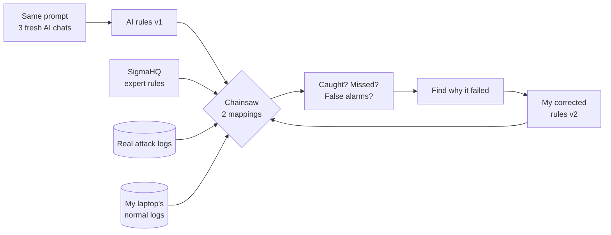
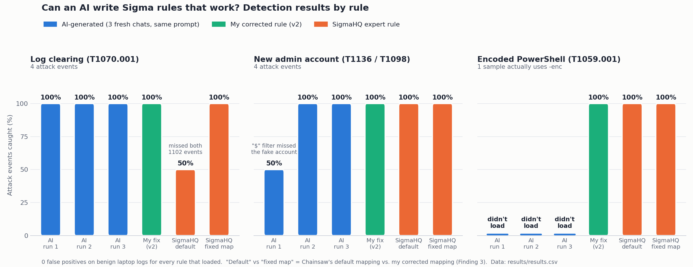

# AI-Assisted Detection Engineering Lab

**Can an AI write Sigma detection rules that actually work?**

This project tests whether a large language model (LLM) can write working detection rules for real attack techniques. Each AI-written rule is run against real attack logs and normal logs, then compared with a corrected version and with the public community rule from SigmaHQ.

*Option B project for INFS 680, McGill University, Fall 2026. Author: Ezat Hassan.*

---

## Research question

When an LLM writes a Sigma rule for a known attack technique:
1. Does the rule **load and run** without errors?
2. Does it **catch the attack** in real attack logs (true positives)?
3. Does it **stay quiet on normal activity** (no false positives)?
4. Is it actually reasoning, or just **reproducing a public rule it memorized**?

## Techniques tested

| # | Technique | MITRE ATT&CK | Key Windows events |
|---|---|---|---|
| 1 | Security event log cleared | T1070.001 | 1102 (Security), 104 (System) |
| 2 | Local account created and added to Administrators | T1136.001 / T1098 | 4720, 4732 |
| 3 | Encoded PowerShell command | T1059.001 | 4104, 4688 / Sysmon 1 |

## Tools and data

| Item | What it is | Why |
|---|---|---|
| [Chainsaw](https://github.com/WithSecureLabs/chainsaw) | Runs Sigma rules directly against Windows event log (.evtx) files | No SIEM needed |
| [SigmaHQ rules](https://github.com/SigmaHQ/sigma) | The public community library of Sigma rules | Baseline to compare against |
| [EVTX-ATTACK-SAMPLES](https://github.com/sbousseaden/EVTX-ATTACK-SAMPLES) | Windows event logs recorded during real attack techniques | Attack test set |
| My own Windows logs | Normal day-to-day activity on my laptop | Benign test set (kept private, not in this repo) |
| LLM | Claude (claude.ai), fresh temporary chats with memory off, Oct 13 2026 | The thing being tested |

No attack tools were run. All attack data comes from published log samples.

## How it works



## Method

For each technique:
1. **Generate.** Give the LLM the same standardized prompt (`prompts/prompt_template.md`) in a fresh chat. Save the rule unchanged as `rules/ai_generated/T####_v1.yml`.
2. **Test.** Run it with Chainsaw against the attack samples and against the benign logs.
3. **Score.** Record whether it loaded, hits on attack files, misses, and hits on benign logs.
4. **Correct.** Fix the rule by hand and save it as `rules/corrected/T####_v2.yml`. Note every change and why.
5. **Compare.** Run the SigmaHQ baseline rule on the same data.
6. **Contamination check.** In a separate chat, ask the LLM to reproduce the SigmaHQ rule from memory, then compare it with the AI rule and with the real SigmaHQ rule.

## Results



Each AI rule was generated **three times** from the same prompt in separate fresh chats, and every rule was tested with **both** Chainsaw's default mapping and a corrected mapping (see Finding 1 below).

| Technique | Rule | Loads? | Attack events caught | Benign false positives |
|---|---|---|---|---|
| T1070.001 Log cleared | AI v1 (3 runs) | ✅ all 3 | **4/4** in every run | 0 |
| T1070.001 Log cleared | Corrected v2 | ✅ | 4/4 (metadata fixes only, verified) | 0 |
| T1070.001 Log cleared | SigmaHQ (2 rules) | ✅ | **2/4 default mapping → 4/4 fixed mapping** | 0 |
| T1136 / T1098 Admin account | AI v1 (3 runs) | ✅ all 3 | **Run 1: 2/4** · Runs 2–3: 4/4 | 0 |
| T1136 / T1098 Admin account | Corrected v2 | ✅ | **4/4** (was 2/4 in run 1) | 0 |
| T1136 / T1098 Admin account | SigmaHQ (3 rules) | ✅ | 4/4 | 0 |
| T1059.001 Encoded PowerShell | AI v1 (3 runs) | ❌ **none load** (`windash` unsupported) | 0/5 files | n/a |
| T1059.001 Encoded PowerShell | Corrected v2 | ✅ | 1/5 files (= 1/1 file that actually uses `-enc`) | 0* |
| T1059.001 Encoded PowerShell | SigmaHQ (2 rules) | ✅ | 1/5 files (same file) | 0* |

\* Not meaningful: the benign logs contain no process-creation events (no Sysmon, 4688 auditing off).
Full per-run detail: `results/results.csv`. Evidence and reasoning: `results/findings_log.md`.

## Key findings

1. **A trusted SigmaHQ rule failed silently.** Chainsaw's default mapping only lets `service: security` rules see events from the `Microsoft-Windows-Security-Auditing` provider. The "Security log cleared" event (1102) is written by `Microsoft-Windows-Eventlog`, so the rule passed linting but never matched: **0/24** across the dataset. Adding the second provider to the mapping fixed it: **24/24**. No error or warning was shown.
2. **Same prompt, different security outcome.** For account creation, two of three AI runs caught every event. The third added a "reduce false positives" filter (`TargetUserName|endswith: '$'`) that excluded exactly the attacker's fake `$` account. SigmaHQ ships a dedicated rule for that trick. A single AI answer is not a reliable sample.
3. **The AI reproduced a public rule and broke it.** All three encoded-PowerShell rules used the same five command-line variants, in the same order, as SigmaHQ's `proc_creation_win_powershell_encode.yml`, added the newer `windash` modifier (unsupported by Chainsaw; 82/82 SigmaHQ rules using it also fail to load), and dropped SigmaHQ's `-Encoding` false-positive filter.
4. **The AI's log-clearing rules beat the default SigmaHQ setup, but not because they were smarter.** They used `product: windows` with a `Channel` field instead of `service: security`, so the mapping blind spot never applied. The trade-off is a broader, more expensive query.
5. **Lesson:** rules (AI-written *or* expert) must be tested in the actual toolchain, against both attack and normal data, and with adversarial edge cases. Syntax checks and plausibility aren't evidence.

## Limitations

- Small test: 3 techniques, one LLM, one set of attack samples.
- Benign logs come from one personal laptop, which may not have Sysmon or process-creation auditing enabled, so some normal activity isn't represented.
- Attack samples were recorded in lab environments, not live company networks.
- LLM output changes between runs and versions; results apply to the model and date tested.

## Repository layout

```
prompts/                 standardized prompts given to the LLM
rules/ai_generated/      rules exactly as the LLM wrote them (v1)
rules/corrected/         my fixed versions (v2), with change notes
rules/sigmahq_baseline/  copies of the SigmaHQ rules used for comparison
results/results.csv      scoring table
results/chainsaw_output/ raw Chainsaw output for each run
report/                  final report
DATA.md                  what test data was used (raw logs are not published)
```

## Reproduce it

Set up Chainsaw, the SigmaHQ rules and the attack samples with `GUIDE_STEP_BY_STEP.md`, then re-run every test with one command:

```powershell
.\run_all.ps1 -Chainsaw D:\lab\chainsaw -Data D:\lab\data
```

It lints every rule, hunts the attack samples and the benign logs with both mappings, and saves a dated CSV in `results/`.
